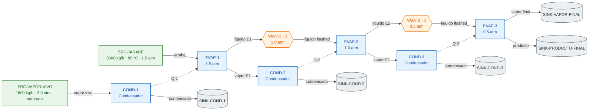
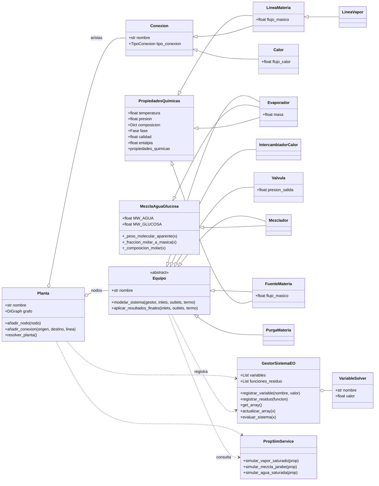
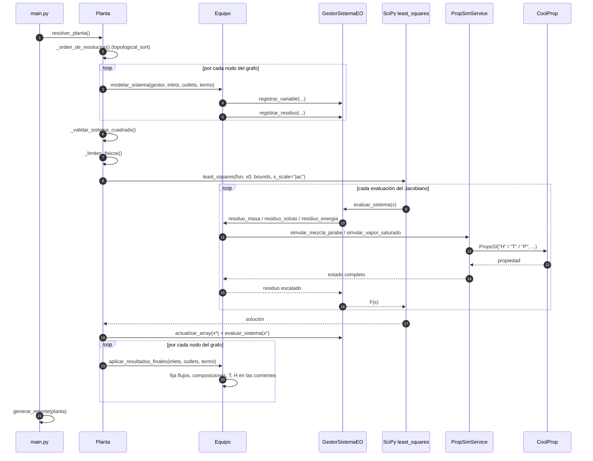
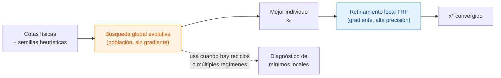

# Evaporadores · Simulador de Trenes de Evaporación de Múltiple Efecto

> Simulación de procesos por **ecuaciones orientadas (EO)** sobre un **grafo dirigido** de equipos, con cierre termodinámico riguroso mediante **CoolProp** y resolución simultánea del *flowsheet* con **SciPy**.


---

## Tabla de contenidos

1. [Descripción general](#1-descripción-general)
2. [Fundamento físico del proceso](#2-fundamento-físico-del-proceso)
   - [2.1 El tren de evaporación de múltiple efecto](#21-el-tren-de-evaporación-de-múltiple-efecto)
   - [2.2 Diagrama de flujo del caso de estudio](#22-diagrama-de-flujo-del-caso-de-estudio)
   - [2.3 Ecuaciones de gobierno](#23-ecuaciones-de-gobierno)
   - [2.4 Cierre termodinámico](#24-cierre-termodinámico)
3. [Arquitectura del software](#3-arquitectura-del-software)
   - [3.1 Por qué ecuaciones orientadas (EO)](#31-por-qué-ecuaciones-orientadas-eo)
   - [3.2 Modelo de clases](#32-modelo-de-clases)
   - [3.3 Ciclo de resolución](#33-ciclo-de-resolución)
   - [3.4 Contrato de un equipo](#34-contrato-de-un-equipo)
4. [Estrategia numérica](#4-estrategia-numérica)
   - [4.1 Cuadratura y escalado](#41-cuadratura-y-escalado)
   - [4.2 Refinamiento local con Trust-Region-Reflective](#42-refinamiento-local-con-trust-region-reflective)
   - [4.3 Búsqueda global evolutiva](#43-búsqueda-global-evolutiva)
5. [Stack termodinámico y librerías](#5-stack-termodinámico-y-librerías)
6. [Estructura del repositorio](#6-estructura-del-repositorio)
7. [Instalación y ejecución](#7-instalación-y-ejecución)
8. [Resultados de referencia](#8-resultados-de-referencia)
9. [Cómo extender el simulador](#9-cómo-extender-el-simulador)
10. [Convenciones de código](#10-convenciones-de-código)
11. [Limitaciones conocidas](#11-limitaciones-conocidas)
12. [Roadmap](#12-roadmap)
13. [Referencias](#13-referencias)

---

## 1. Descripción general

Este proyecto implementa un simulador estacionario de **trenes de evaporación de múltiple efecto (MEE)** para concentración de jarabe de glucosa. A diferencia de un simulador secuencial-modular clásico —donde cada equipo se resuelve en orden y los reciclos requieren iteraciones externas—, aquí **todo el tren se plantea como un único sistema de ecuaciones no lineales**:

$$
\mathbf{F}(\mathbf{x}) = \mathbf{0}, \qquad \mathbf{x} \in \mathbb{R}^{n}
$$

Donde:

- $\mathbf{x}$ son las incógnitas del proceso (flujos, composiciones, temperaturas y calores).
- $\mathbf{F}$ son los residuos de **conservación de masa, especie y energía** de cada equipo.
- La **termodinámica** (entalpías, saturación, aumento ebulloscópico) se evalúa *dentro* de cada evaluación del residuo, de modo que el sistema siempre está cerrado termodinámicamente.

**Capacidades actuales**

| Capacidad | Implementación |
|---|---|
| Equipos | Evaporador, condensador, válvula de expansión, mezclador, fuente, sumidero |
| Topología | Grafo dirigido (`networkx.DiGraph`) con orden topológico y tolerancia a reciclos |
| Termodinámica | CoolProp 8 (IAPWS-95 para agua), mezcla agua–glucosa con BPE empírico |
| Solver | `scipy.optimize.least_squares` (Trust-Region-Reflective) con cotas físicas |
| Unidades | SI internamente en las propiedades; flujos másicos en kg/h y calores en J/h en la capa de proceso |

---

## 2. Fundamento físico del proceso

### 2.1 El tren de evaporación de múltiple efecto

El objetivo del tren es **retirar agua** de una disolución de glucosa minimizando el consumo de vapor. La clave energética es el **reuso del vapor generado**: el vapor que hierve en el efecto $i$ (a mayor presión y temperatura) se usa como medio de calentamiento del efecto $i+1$ (a menor presión y temperatura). Cada kilogramo de vapor vivo evapora, por tanto, más de un kilogramo de agua.

Los tres fenómenos que gobiernan el equipo son:

1. **Equilibrio líquido-vapor con soluto no volátil.** La glucosa permanece íntegramente en la fase líquida; el vapor es agua prácticamente pura.
2. **Elevación del punto de ebullición (BPE).** La presencia de soluto reduce la actividad del agua y eleva la temperatura de ebullición por encima de la del agua pura a la misma presión. Este efecto degrada la fuerza impulsora térmica entre efectos y es indispensable para reproducir un tren MEE realista.
3. **Expansión isentálpica entre efectos.** El líquido que abandona un efecto está a mayor temperatura que el siguiente; al pasar por la válvula se despresuriza y parte del agua se *flashea*, generando vapor adicional que también se aprovecha.

La **economía de vapor** —indicador de desempeño del tren— se define como

$$
\text{economía} = \frac{\dot m_{\text{agua evaporada}}}{\dot m_{\text{vapor vivo}}}
$$

y crece con el número de efectos, a costa de área de transferencia y de vacío creciente en la cola del tren.

### 2.2 Diagrama de flujo del caso de estudio

El caso implementado en `main.py` es un tren de **3 efectos** con condensadores de servicio, dos válvulas de expansión y un producto concentrado:



Las líneas continuas son materia y las punteadas son energía (`Calor`). El grafo resultante tiene **15 nodos y 16 aristas**, y es acíclico: el orden topológico determina el orden de inscripción de ecuaciones, aunque el sistema se resuelva de forma simultánea.

### 2.3 Ecuaciones de gobierno

Para cada evaporador $i$, con alimentación $F$, líquido concentrado $L$ y vapor $V$:

**Balance global de materia**

$$
\dot m_F = \dot m_L + \dot m_V
$$

**Balance de soluto (glucosa no volátil)**

$$
\dot m_F\, w_{g,F} = \dot m_L\, w_{g,L}
$$

**Balance de energía**

$$
\dot n_F H_F + \dot Q_i = \dot n_L H_L + \dot n_V H_V + \dot Q_{\text{pérdidas}}
$$

con $\dot n = \dot m / M$ y $H$ en base molar `[J/mol]`. En la implementación $\dot Q_{\text{pérdidas}} = 0$ y el calor lo aporta la corriente `Calor` proveniente del condensador aguas arriba.

**Conversión de composición.** El estado se transporta en fracción molar de glucosa $x_g$; los balances de soluto se plantean en base másica, por lo que se requiere

$$
w_g = \frac{x_g M_g}{x_w M_w + x_g M_g}, \qquad M_w = 18.015\ \text{g/mol},\quad M_g = 180.156\ \text{g/mol}
$$

**Válvula isentálpica**

$$
H_{\text{in}} = H_{\text{out}}, \qquad P_{\text{out}} = P_{\text{objetivo}}
$$

**Condensador.** El vapor de servicio condensa a líquido saturado y entrega el calor latente:

$$
\dot Q = \dot n\,(H_{V} - H_{L})
$$

La implementación resuelve un balance 1:1 en flujo (sin incógnita de masa) y una única incógnita de calor, con la energía liberada escalada a `MW` para el solver y devuelta a `J/h` en la corriente `Calor`.

### 2.4 Cierre termodinámico

Las propiedades no se tabulan: se **consultan a un motor de estados**. Para agua pura, `PropSimService` usa CoolProp con pares de estado de saturación $(P,Q)$ o $(T,Q)$:

$$
T_{\text{sat}} = f(P, Q), \qquad P_{\text{sat}} = f(T, Q), \qquad H_{\text{sat}} = f(P, Q)
$$

Para el jarabe se aplica un modelo de mezcla con **regla de mezclado para el calor específico** y **BPE empírico**:

$$
c_{p,\text{mezcla}} = w_g\, c_{p,g} + (1 - w_g)\, c_{p,w}
$$

$$
\Delta T_{eb} = 1.78\,w_g + 6.22\,w_g^{2}\ \ [\text{K}]
$$

$$
T_{\text{ebull,jarabe}}(P) = T_{\text{sat,agua}}(P) + \Delta T_{eb}(w_g)
$$

$$
H_L = c_{p,\text{mezcla}}\,(T - T_{\text{ref}})
$$

con $T_{\text{ref}} = 273.15\ \text{K}$, $c_{p,w} = 4186\ \text{J kg}^{-1}\text{K}^{-1}$ y $c_{p,g} = 1255\ \text{J kg}^{-1}\text{K}^{-1}$.

> El BPE es hoy una correlación empírica cuadrática en fracción másica. El reemplazo riguroso por **coeficientes de actividad** ($\gamma_i$ vía UNIQUAC/NRTL) está identificado en el [roadmap](#12-roadmap): permitiría obtener $a_w$ y con ella el BPE por equilibrio, además de la composición real del vapor.

---

## 3. Arquitectura del software

### 3.1 Por qué ecuaciones orientadas (EO)

En un esquema secuencial-modular, cada equipo requiere que todas sus entradas estén numéricamente disponibles. Con reciclos (p. ej. recompresión de vapor, recirculación de jarabe) esto obliga a iteraciones externas y a tolerancias anidadas, con convergencia frágil y difícil de diagnosticar.

El enfoque **EO** invierte el problema:

1. Cada equipo **declara** sus incógnitas y sus ecuaciones, sin resolver nada.
2. El orquestador ensambla un sistema global $\mathbf{F}(\mathbf{x}) = \mathbf{0}$.
3. Un único solver encuentra la solución simultánea.

Ventajas concretas en este dominio:

- **Reciclos sin iteraciones anidadas:** basta con que existan las incógnitas; la topología deja de condicionar la convergencia.
- **Diagnóstico por ecuación:** un residuo que no se anula identifica directamente el balance mal planteado.
- **Orden de magnitud verificable:** $n_{\text{incógnitas}} = n_{\text{ecuaciones}}$ es una condición necesaria y comprobable en tiempo de ejecución.

### 3.2 Modelo de clases



**Separación de responsabilidades**

| Capa | Archivo | Responsabilidad |
|---|---|---|
| Entidades | `core/schemas/base.py` | Enums, `Conexion`, `PropiedadesQuimicas`, mezcla agua–glucosa, interfaz `Equipo` |
| Corrientes | `core/schemas/streams.py` | `LineaMateria`, `LineaVapor`, `Calor` |
| Física de equipos | `core/schemas/engine.py` | Traducción de cada equipo a variables y residuos |
| Orquestación | `core/schemas/planta.py` | Grafo, orden topológico, cotas, solver, post-proceso |
| Álgebra del sistema | `core/services/ecuaciones_manager.py` | Registro de incógnitas/residuos y vector objetivo |
| Termodinámica | `core/services/thermo_service.py` | CoolProp, BPE, $c_p$, conversiones molares |

### 3.3 Ciclo de resolución



Puntos finos del diseño:

- Las corrientes **son objetos compartidos** entre nodos (misma instancia en aristas de entrada y salida). Por eso los residuos pueden ser *mutantes*: al evaluarse escriben el estado iterado en la corriente, de modo que el equipo aguas abajo ve valores coherentes durante la iteración.
- `aplicar_resultados_finales` es el único lugar donde el estado convergido se fija definitivamente y se propaga al propio equipo (temperatura, composición, entalpía y fase del volumen de retención).

### 3.4 Contrato de un equipo

Todo nodo hereda de `Equipo` y cumple dos métodos. El contrato es deliberadamente mínimo:

```python
from dataclasses import dataclass
from typing import List

from core.schemas.base import Conexion, Equipo
from core.services.ecuaciones_manager import GestorSistemaEO
from core.services.thermo_service import PropSimService


@dataclass
class SeparadorFlash(Equipo):
    """Separa una corriente en vapor y líquido en equilibrio."""

    presion_operacion: float

    def modelar_sistema(
        self,
        gestor: GestorSistemaEO,
        inlets: List[Conexion],
        outlets: List[Conexion],
        termo: PropSimService,
    ) -> None:
        self._seleccionar_corrientes(inlets, outlets)
        self._registrar_incognitas(gestor)
        gestor.registrar_residuo(self._residuo_masa)
        gestor.registrar_residuo(self._residuo_energia)

    def aplicar_resultados_finales(
        self,
        inlets: List[Conexion],
        outlets: List[Conexion],
        termo: PropSimService,
    ) -> None:
        self._seleccionar_corrientes(inlets, outlets)
        self._actualizar_salidas(termo)
```

Reglas de oro al escribir un equipo:

1. **Idempotencia:** `modelar_sistema` no debe resolver nada; solo declarar.
2. **Escalado:** los residuos deben quedar en el mismo orden de magnitud (por eso se divide la energía entre `1e6`).
3. **Sin ramas ocultas:** las corrientes se localizan con `_seleccionar_corrientes` y fallan con `ValueError` si falta alguna, para no enmascarar topologías inválidas.
4. **Determinismo:** un equipo no debe depender de que se lo haya llamado antes.

---

## 4. Estrategia numérica

### 4.1 Cuadratura y escalado

El sistema debe ser **cuadrado** ($n_{\text{vars}} = n_{\text{ecs}}$); `Planta._validar_sistema_cuadrado` aborta con un mensaje explícito si no lo es. Para el caso de 3 efectos el sistema resultante es de **20 × 20**.

Tres decisiones sostienen el condicionamiento:

| Decisión | Motivo |
|---|---|
| Residuos de energía divididos por $10^6$ | Alinea `J/h` y `J/mol·h` con los residuos de masa (`kg/h`), evitando que el Jacobiano tenga filas 6 órdenes de magnitud mayores |
| `x_scale="jac"` | SciPy normaliza cada columna por la norma del Jacobiano, compensando el rango dinámico entre flujos (10³) y fracciones molares (10⁻¹) |
| Cotas por nombre de variable | `xg` → $[0, 0.999]$; `T_out`/`temperatura` → $[283.15, 573.15]$ K; flujos y calores → $[0, \infty)$ |

Las cotas no son arbitrarias: son **dominio físico**. Sin ellas, el solver puede explorar fracciones molares negativas o temperaturas bajo el punto triple, y CoolProp lanza excepciones de estado en lugar de devolver un residuo grande pero finito.

### 4.2 Refinamiento local con Trust-Region-Reflective

La resolución de producción usa `scipy.optimize.least_squares` con `method="trf"` implícito:

```python
solucion = least_squares(
    fun=gestor.evaluar_sistema,
    x0=gestor.get_array(),
    bounds=(limites_inferiores, limites_superiores),
    loss="linear",
    x_scale="jac",
    max_nfev=5000,
)
```

¿Por qué mínimos cuadrados no lineales y no un Newton multifunción (`root`)?

- **Robustez ante el sobreajuste:** si el sistema es cuadrado pero mal condicionado, TRF sigue produciendo un paso útil; un Newton puro puede fallar por Jacobiano singular.
- **Cotas nativas:** TRF es uno de los pocos métodos de SciPy que soporta *bounds* directamente, imprescindibles aquí.
- **`loss="linear"`** exige precisión absoluta en todas las ecuaciones (frente a `soft_l1`, que toleraría residuos grandes).
- **`max_nfev=5000`** da margen suficiente considerando que cada evaluación implica decenas de llamadas a CoolProp.

### 4.3 Búsqueda global evolutiva

El punto débil de cualquier método local es $\mathbf{x}_0$. Cuando el sistema tiene varios regímenes posibles, restricciones activas en las cotas o superficies de residuo con zonas planas —caso típico en *flowsheets* EO con reciclos y cambios de fase—, un arranque desafortunado conduce a un mínimo local con residuo grande, o a un falso "convergió" en una solución no física.

Frente a esto, la alternativa son los **algoritmos evolutivos poblacionales**, cuyo representante canónico en `scipy` es `differential_evolution`: una estrategia **derivada de los algoritmos genéticos**, con los mismos tres operadores conceptuales:

| Operador genético | Equivalente en Differential Evolution |
|---|---|
| Población de individuos | Conjunto de vectores candidatos $\mathbf{x}^{(1..NP)}$ |
| Mutación | $\mathbf{v} = \mathbf{x}_{r_1} + F\,(\mathbf{x}_{r_2} - \mathbf{x}_{r_3})$ |
| Cruce (*crossover*) | Recombina componentes del vector mutado con el individuo objetivo |
| Selección | El hijo reemplaza al padre solo si mejora la función objetivo |

**¿Por qué encaja con este problema?**

1. **No necesita gradiente.** Los residuos incluyen `PropsSI`, que devuelve discontinuidades numéricas en la frontera de saturación; un Jacobiano por diferencias finitas puede ser ruidoso. Un método poblacional no lo usa.
2. **No le afecta el escalado.** Compara valores de la función objetivo, no derivadas; el rango dinámico entre `kg/h` y fracciones molares deja de ser crítico.
3. **Explora la caja completa.** Con las cotas físicas ya definidas, el algoritmo barre el espacio factible y localiza la **cuenca de atracción** correcta sin depender de una semilla heurística.
4. **Paralelizable.** Las evaluaciones de la población son independientes: se pueden repartir con `workers` o `updating="deferred"`, algo imposible en un método de trayectoria única.
5. **Es el estándar de la industria EO.** Los simuladores comerciales usan inicialización estocástica/global precisamente porque el sistema de ecuaciones del *flowsheet* es no convexo.

**El costo y el compromiso.** Cada individuo es una evaluación completa del *flowsheet*, y cada evaluación del *flowsheet* dispara decenas de llamadas a CoolProp. Un barrido global de calidad requiere miles de individuos-evaluación; TRF converge en decenas. Por eso la arquitectura separa dos etapas con roles distintos:



> **Estado actual.** El pipeline en producción es **TRF sobre semillas heurísticas con cotas físicas** (`Planta._resolver_sistema`); no invoca todavía la etapa evolutiva. La búsqueda global está especificada y su dependencia (`scipy.optimize.differential_evolution`) ya está disponible en el entorno. La etapa se activará para el arranque de casos con reciclos y como verificación de globalidad del óptimo, tal como se detalla en el [roadmap](#12-roadmap).

**Semillas heurísticas vigentes** (baratas y suficientes para un tren acíclico):

| Incógnita | Semilla |
|---|---|
| Flujo de líquido y vapor | 50 % del flujo de alimentación |
| Fracción molar de glucosa a la salida | $1.5\,x_{g,\text{in}}$, acotada a 0.99 |
| Temperatura de salida del mezclador | 25 °C |
| Calor liberado en el condensador | $2.2\,\dot m_{\text{vapor}}$ |
| Condiciones faltantes de una corriente | 1 atm, 1000 kg/h, composición 95/5 |

---

## 5. Stack termodinámico y librerías

| Librería | Versión | Rol en el proyecto | Por qué esta y no otra |
|---|---|---|---|
| **CoolProp** | 8.0.0 | Estados del agua: $T_{\text{sat}}$, $P_{\text{sat}}$, $H$ en saturación | Implementa **IAPWS-95** y las ecuaciones de transporte asociadas, con precisión de referencia y sin necesidad de tablas ni de programar correlaciones. `PropsSI` permite fijar pares de estado como $(P,Q)$, clave para resolver saturación sin iterar a mano |
| **thermo** | 0.6.1 | Coeficientes de actividad y estimación de propiedades (instalada, pendiente de cablear) | Aporta `Chemical` y modelos de $G^E$ (UNIQUAC/NRTL) para reemplazar el BPE empírico por equilibrio con $\gamma_i$ |
| **SciPy** | 1.17.1 | `least_squares` (TRF) y `differential_evolution` | Solvers probados, con cotas, escalado y pérdidas robustas; evita reimplementar Levenberg–Marquardt |
| **NetworkX** | 3.6.1 | Grafo dirigido, `topological_sort`, consulta de aristas | Modela el *flowsheet* como estructura de datos de primera clase y detecta reciclos (`NetworkXUnfeasible`) |
| **NumPy** | 2.4.6 | Vectores de incógnitas y residuos | Interfaz natural de SciPy y vectorización de las evaluaciones |

**Nota sobre unidades.** CoolProp devuelve propiedades **másicas** (`J/kg`); la capa de proceso trabaja en **base molar** (`J/mol`) porque los balances de energía con composición variable son más limpios así. La conversión ocurre en un único punto (`PropSimService._entalpia_molar`), evitando el error clásico de mezclar bases en distintos equipos.

---

## 6. Estructura del repositorio

```text
Evaporadores/
├── main.py                          # Caso de estudio: tren MEE de 3 efectos + reporte
├── README.md
├── .devcontainer/
│   ├── Dockerfile                   # Python 3.11 + build-essential + stack científico
│   └── devcontainer.json
├── core/
│   ├── schemas/
│   │   ├── base.py                  # Enums, Conexion, PropiedadesQuimicas, MezclaAguaGlucosa, Equipo (ABC)
│   │   ├── streams.py               # LineaMateria, LineaVapor, Calor
│   │   ├── engine.py                # Evaporador, Mezclador, Valvula, IntercambiadorCalor, FuenteMateria, PurgaMateria
│   │   └── planta.py                # Planta: grafo, cotas, solver, cierre de resultados
│   └── services/
│       ├── ecuaciones_manager.py    # GestorSistemaEO + VariableSolver
│       └── thermo_service.py        # PropSimService (CoolProp, BPE, cp, conversiones)
├── docs/
│   └── ecuaciones.md                # Desarrollo analítico de las ecuaciones
├── test/
│   └── test.py                      # Planta de 1 efecto como prueba de integración
└── ui/
    ├── schemas/                     # vacío · reservado para DTOs de presentación
    └── services/                    # vacío · reservado para orquestación de UI
```

La dirección de dependencias es unidireccional: `schemas.engine` y `schemas.planta` dependen de `services`, y `services.thermo_service` depende de `schemas.base`. `base.py` solo referencia los servicios bajo `TYPE_CHECKING`, lo que evita ciclos de importación y permite usar las entidades sin cargar el solver.

---

## 7. Instalación y ejecución

### 7.1 Dev container (recomendado)

El repositorio incluye `.devcontainer/` con Python 3.11 y el *stack* científico. En VS Code:

```text
Ctrl+Shift+P  →  Dev Containers: Reopen in Container
```

### 7.2 Entorno local

```bash
python3 -m venv .venv
source .venv/bin/activate
pip install numpy scipy networkx CoolProp thermo
```

### 7.3 Ejecución

```bash
# Tren de 3 efectos + reporte técnico
python -m main

# Prueba de integración de 1 efecto
PYTHONPATH=. python test/test.py
```

Salida esperada de la prueba de integración:

```text
--- Iniciando Resolución de Planta: Planta Evaporadora Simple ---
Topología procesada. Sistema EO: 8 variables y 8 ecuaciones.
Ejecutando SciPy Least-Squares con límites físicos...
Convergencia exitosa. Error residual: 2.84e-26
```

---

## 8. Resultados de referencia

Salida de `python -m main` con la configuración por defecto:

| Efecto | Presión | T ebullición | $x_{\text{glucosa}}$ |
|---:|---:|---:|---:|
| 1 | 1.50 atm | 114.06 °C | 0.0857 |
| 2 | 1.00 atm | 103.11 °C | 0.1220 |
| 3 | 0.50 atm | 89.64 °C | 0.9990 |

| Indicador | Valor |
|---|---:|
| Alimentación | 5000.00 kg/h |
| Vapor vivo consumido | 1800.00 kg/h |
| Agua evaporada total | 4603.41 kg/h |
| Jarabe concentrado | 673.92 kg/h |
| **Economía de vapor** | **2.56** kg agua / kg vapor vivo |

La progresión de temperaturas (114.06 → 103.11 → 89.64 °C) reproduce el comportamiento esperado de un tren MEE: cada efecto hierve a menor temperatura porque opera a menor presión, y el vapor del efecto anterior condensa a mayor temperatura, garantizando $\Delta T > 0$ en cada condensador.

---

## 9. Cómo extender el simulador

### 9.1 Añadir un equipo

1. Crear la clase en `core/schemas/engine.py` heredando de `Equipo` (y de `PropiedadesQuimicas` si el equipo tiene estado propio).
2. Implementar `modelar_sistema` con selectores privados (`_seleccionar_corrientes`, `_preparar_entrada`), registro de incógnitas y residuos por balance.
3. Implementar `aplicar_resultados_finales` para fijar el estado convergido.
4. Instanciarlo en `main.py::_crear_equipos` y conectarlo en `_conectar_efecto_*`.
5. Verificar que el sistema siga cuadrado: si añades una incógnita, añade exactamente una ecuación.

### 9.2 Añadir una sustancia

Las sustancias viven en `Sustancias` (`core/schemas/base.py`). Para una mezcla multicomponente habrá que generalizar `MezclaAguaGlucosa` a una mezcla $n$-aria con pesos moleculares por componente y, en `PropSimService`, sustituir el BPE empírico por coeficientes de actividad.

### 9.3 Cambiar el solver

`Planta._resolver_sistema` es el único punto de acoplamiento con SciPy. Cualquier estrategia (TRF, `differential_evolution` + TRF, o *continuation* en presión) se implementa ahí sin tocar los equipos.

---

## 10. Convenciones de código

- **Autodocumentación.** Sin comentarios `#` en el código: la intención se expresa con nombres de métodos privados y docstrings. Cada bloque de lógica no trivial vive en un método con nombre propio (`_residuo_soluto`, `_actualizar_condensado`, `_limites_fisicos`).
- **Métodos privados** para todo lo que no sea contrato público. El contrato de un equipo son exactamente dos métodos.
- **Constantes con nombre** en el encabezado de cada módulo (`_PRESION_ATMOSFERICA`, `_ESCALA_ENERGIA`, `_TEMPERATURA_REFERENCIA`); cero números mágicos enterrados en las fórmulas.
- **Tipado gradual** en todas las firmas públicas (`List[Conexion]`, `float | None`, `Dict[str, float]`).
- **`dataclasses`** para entidades y equipos: igualdad estructural, `repr` legible y cero *boilerplate*.
- **Fallos explícitos.** Un equipo sin la corriente esperada lanza `ValueError` con el rol faltante; un sistema no cuadrado lanza con ambos conteos.

---

## 11. Limitaciones conocidas

| Limitación | Impacto | Mitigación prevista |
|---|---|---|
| BPE empírico cuadrático | El vapor se asume agua pura y el BPE no depende de $T$ | Modelo de actividad (UNIQUAC) y equilibrio $\gamma$–$\phi$ |
| La válvula no resuelve el *flash* bifásico | El paso por válvula se trata como líquido con cierre isentálpico | Flash isotérmico con calidad como incógnita |
| Efecto 3 alcanza la cota $x_g = 0.999$ | Indica que el caso base está sobreexigido (evapora más agua de la físicamente disponible) | Recalibrar el caso de estudio o añadir límite de solubilidad |
| Residuos de energía escalados | El `cost` reportado no es interpretable como energía | Reportar residuos normalizados por ecuación |
| Sin reciclos en el caso base | La tolerancia a ciclos está implementada pero no ejercitada | Caso con recompresión mecánica de vapor (MVR) |
| Sin suite de tests automática | La validación es manual (`main.py` y `test/test.py`) | `pytest` con casos de referencia y pruebas de Gibbs–Duhem |

---

## 12. Roadmap

- [ ] **Coeficientes de actividad**: UNIQUAC/NRTL para agua–glucosa, $a_w$ y BPE por equilibrio, validación con Gibbs–Duhem.
- [ ] **Flash bifásico** en válvula y evaporador, con calidad como variable del sistema.
- [ ] **Etapa de búsqueda global evolutiva** cableada en `Planta._resolver_sistema` (población → TRF), con criterio de activación automática ante fallo de convergencia.
- [ ] **Suite `pytest`**: balances cerrados, monotonía de la economía de vapor, regresión numérica del caso base.
- [ ] **`requirements.txt` / `pyproject.toml`** con versiones fijas.
- [ ] **Caso MVR** para ejercitar reciclos y la tolerancia a ciclos del grafo.
- [ ] **Capa `ui/`**: visualización del grafo y edición de la topología.

---

## 13. Referencias

1. Smith, R. *Chemical Process Design and Integration*. Wiley.
2. Westerberg, A. W.; Hutchison, H. P.; Motard, R. L.; Winter, P. *Process Flowsheeting*. Cambridge University Press.
3. Perry, R. H.; Green, D. W. *Perry's Chemical Engineers' Handbook* — Evaporation.
4. Bell, I. H.; Wronski, J.; Quoilin, S.; Lemort, V. *Pure and Pseudo-pure Fluid Thermophysical Property Evaluation and the Open-Source Thermophysical Property Library CoolProp*. Ind. Eng. Chem. Res., 2014.
5. IAPWS. *Revised Release on the IAPWS Formulation 1995 for the Thermodynamic Properties of Ordinary Water Substance*.
6. Abrams, D. S.; Prausnitz, J. M. *Statistical thermodynamics of liquid mixtures: A new expression for the excess Gibbs energy of partly or completely miscible systems*. AIChE J., 1975.
7. Storn, R.; Price, K. *Differential Evolution — A Simple and Efficient Heuristic for Global Optimization over Continuous Spaces*. J. Global Optim., 1997.
8. Branch, M. A.; Coleman, T. F.; Li, Y. *A Subspace, Interior, and Conjugate Gradient Method for Large-Scale Bound-Constrained Minimization Problems*. SIAM J. Sci. Comput., 1999.

---

<div align="center">

**Evaporadores** · simulación EO de trenes MEE con cierre termodinámico riguroso

</div>
